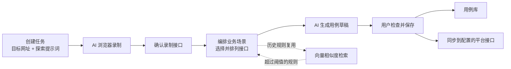
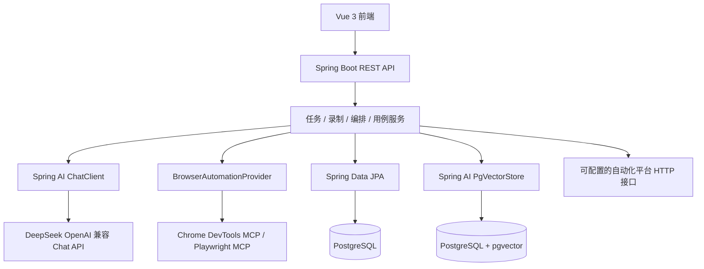

# TestPilot

**TestPilot 是一个基于 AI Agent 的接口自动化用例生成平台。** 用户用自然语言描述希望探索的网站和业务流程，Agent 操作浏览器并采集接口请求/响应；用户确认接口并编排成业务场景后，大模型生成结构化 API 自动化用例，供用户检查、保存和同步。

> 项目面向 AI 应用与 Agent 工程实践，采用“模型执行 + 用户确认 + 后端校验”的流程，避免把整个测试过程交给一次不受约束的模型调用。

## 核心流程



## 主要能力

- **自然语言驱动网页探索：** 用户填写目标网址和探索提示词，录制 Agent 读取页面状态，并通过受限的浏览器工具执行点击、输入、等待和重新读取页面等操作。
- **接口请求录制：** 浏览器 MCP 采集网络请求和响应，后端保存 URL、方法、状态码、请求/响应头及内容，并对常见密钥字段脱敏；用户可以确认保留哪些接口。
- **业务场景编排：** 用户可将接口拖拽成有序调用链，保存多个场景，也可搜索、复用历史规则或调整后另存为新规则。规则层只描述接口和顺序，测试入参与断言在用例生成阶段处理。
- **向量检索历史规则：** 使用 Spring AI PgVectorStore 和 PostgreSQL pgvector 索引规则名称、场景说明和接口顺序；按余弦相似度检索，只推荐超过可配置阈值的规则，并显示相似度分数。
- **结构化用例生成：** 大模型结合场景顺序、录制请求/响应和用户补充提示词，生成入参、跨接口变量、前置处理和后置校验。后端校验生成结果与场景接口顺序，再作为草稿交给用户确认。
- **用例管理和平台同步：** 提供用例库、规则库、用户注册登录及管理员逻辑；用户保存用例后，系统通过可配置 HTTP 接口同步。
- **异步任务控制：** 录制任务有持久化状态，支持查询进度、重试、终止和并发限制。

## 设计重点

1. **将 Agent 能力收敛到工具调用。** 模型通过明确的工具定义操作页面；浏览器实现遵循统一 Provider 接口，使录制流程不绑定到单一 MCP 实现。
2. **按阶段持久化工作流。** 录制、接口确认、场景编排和用例生成分别管理，用户可在关键节点检查和修正模型结果。
3. **区分场景与用例。** 编排规则可跨任务复用接口顺序；用例生成阶段再结合真实录制数据补充测试细节。
4. **校验模型输出。** 用提示词模板约束 JSON 结构，后端再校验场景和接口顺序，避免模型改写用户编排。
5. **对接能力可替换。** 浏览器通过 Provider 抽象，聊天模型、Embedding 服务和自动化平台地址均通过配置管理。

## 架构概览



## 技术栈

| 模块 | 技术 |
| --- | --- |
| 后端 | Java 17、Spring Boot 3.3.5、Spring Web、Spring Data JPA |
| Agent / LLM | Spring AI 1.0.0、ChatClient、Tool Calling、MCP Client |
| 模型接入 | DeepSeek OpenAI 兼容 Chat API；独立的 OpenAI 兼容 Embedding API |
| 浏览器 | Chrome DevTools MCP（默认）、Playwright MCP、Provider 抽象 |
| 向量检索 | PostgreSQL 16、pgvector、Spring AI PgVectorStore、余弦相似度阈值 |
| 前端 | Vue 3、Vue Router、Vite、vuedraggable |
| 本地环境 | Docker Compose、Maven、Node.js / npm |

## 本地启动

### 环境要求

- JDK 17+
- Maven 3.8+
- Node.js 18+ 和 npm
- Docker Desktop 或 Docker Engine
- 可用的 DeepSeek Chat API
- 可用的 OpenAI 兼容 Embedding API（规则向量推荐需要）

### 1. 启动 PostgreSQL + pgvector

在项目根目录执行：

```bash
docker compose up -d
```

默认数据库配置见 [`docker-compose.yml`](docker-compose.yml) 和 [`application.yml`](src/main/resources/application.yml)。本地演示配置不适合直接用于生产环境。

### 2. 配置模型

在项目根目录创建 `.env`（已被 Git 忽略），填写模型服务配置。`.env` 文件会由 Spring Boot 读取：

```dotenv
DEEPSEEK_API_KEY=你的DeepSeek密钥
DEEPSEEK_BASE_URL=https://api.deepseek.com
DEEPSEEK_CHAT_MODEL=deepseek-v4-pro

EMBEDDING_API_KEY=你的Embedding服务密钥
EMBEDDING_BASE_URL=https://你的OpenAI兼容Embedding服务地址
EMBEDDING_MODEL=你的Embedding模型名
EMBEDDING_DIMENSIONS=1536
RULE_RECOMMENDATION_SIMILARITY_THRESHOLD=0.70
```

Embedding 服务与聊天模型分开配置。所选模型的向量维度必须与 `EMBEDDING_DIMENSIONS` 一致；只使用 DeepSeek Chat 而没有配置 Embedding API 时，聊天和用例生成可使用，但历史规则向量推荐无法工作。

### 3. 启动后端

从项目根目录运行，确保应用能找到 `.env`：

```bash
mvn spring-boot:run
```

后端默认地址：<http://localhost:8080>。JPA 会在本地开发环境更新业务表结构，PgVectorStore 初始化向量存储结构。

### 4. 启动前端

新开一个终端：

```bash
cd frontend
npm install
npm run dev
```

前端默认地址：<http://localhost:5173>。用户可通过注册页面创建账号；本地管理员配置见 `application.yml`。

## 配置说明

| 配置 | 说明 |
| --- | --- |
| `DEEPSEEK_API_KEY` | DeepSeek Chat API 密钥 |
| `DEEPSEEK_BASE_URL` | Chat API 地址，默认 `https://api.deepseek.com` |
| `DEEPSEEK_CHAT_MODEL` | Chat 模型名 |
| `EMBEDDING_API_KEY` | Embedding 服务密钥，需与 Chat 密钥分开配置 |
| `EMBEDDING_BASE_URL` | OpenAI 兼容 Embedding API 地址 |
| `EMBEDDING_MODEL` | Embedding 模型名 |
| `EMBEDDING_DIMENSIONS` | 模型向量维度，必须与所选模型匹配 |
| `RULE_RECOMMENDATION_SIMILARITY_THRESHOLD` | 规则推荐阈值，默认 `0.70` |
| `TESTPILOT_PLATFORM_SYNC_URL` | 自动化平台同步接口，默认指向本地 mock endpoint |

## 目录结构

```text
src/main/java/com/testpilot/
├── browser/       # 浏览器 Provider 抽象及 MCP 实现
├── config/        # Spring AI、MCP、线程池等配置
├── controller/    # REST API
├── domain/        # 任务、接口、规则、用例等实体
├── dto/           # API 请求和响应对象
├── repository/    # Spring Data JPA 仓储
└── service/       # Agent 工作流、规则检索、用例生成等服务
src/main/resources/
├── application.yml
└── prompts.yml    # 集中管理的系统提示词模板
frontend/          # Vue 3 前端
database/          # 手动数据库迁移
spec/              # 产品 API 规格及交互示意图
docs/              # 使用和运维说明
```

## 当前边界与安全说明

- 平台同步默认调用项目内的本地 mock endpoint；接入真实自动化平台时，需要按目标平台的数据格式和鉴权方式配置或扩展适配逻辑。
- 规则向量推荐依赖单独配置的 Embedding 服务；余弦相似度代表文本语义相近，不等同于严格的接口顺序校验。
- `application.yml` 包含便于本地开发的数据库、管理员和 JWT 默认配置。公开部署前应移除或替换这些默认值，并使用环境变量或密钥管理服务保存凭证。
- 不要提交 `.env`、真实 API Key、个人数据或浏览器运行日志；仓库已通过 `.gitignore` 忽略 `.env`、构建目录、前端依赖和 `.playwright-mcp/`。

更多接口和设计细节见 [`docs/README.md`](docs/README.md)、[`spec/SPEC-2026-10-19-API.md`](spec/SPEC-2026-10-19-API.md) 和 [`spec/`](spec/) 下的交互示意图。
